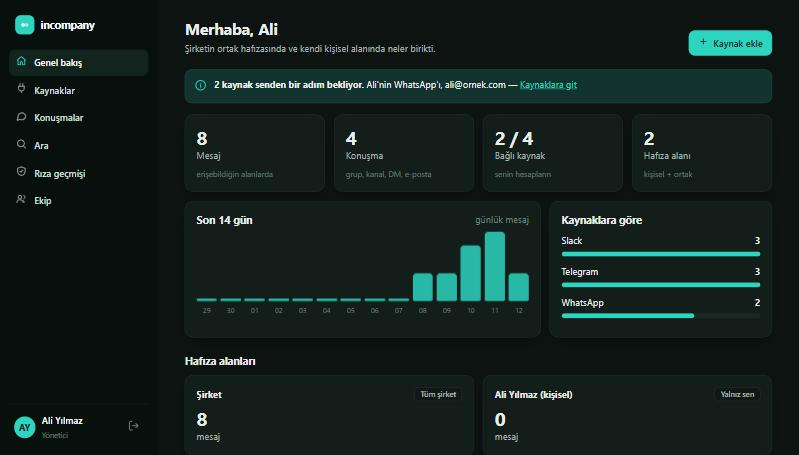
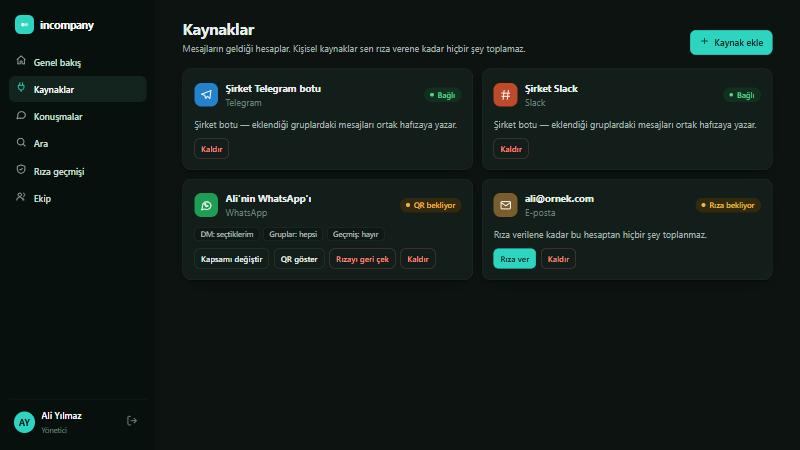
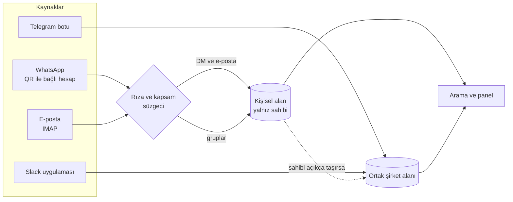

<div align="center">


# incompany

**Şirketin ortak hafızası. Rızasız hiçbir şey toplamaz.**

WhatsApp, Telegram, Slack ve e-postadaki yazışmaları tek bir aranabilir hafızada toplar.<br>
Kişisel kaynaklar, sahibi açıkça onay vermeden çalışmaz.


[Hızlı deneme](#-hızlı-deneme) · [Kurulum](#-kurulum) · [Nasıl çalışır](#-nasıl-çalışır) · [Gizlilik ve rıza](#-gizlilik-ve-rıza) · [Uyarılar](#-uyarılar)

</div>

<br>

<p align="center">
  
  
</p>

## ✨ Neler yapar

| | |
|---|---|
| 💬 **Tek hafıza** | WhatsApp, Telegram, Slack ve e-posta tek yerde, Türkçe tam metin aramayla. |
| 🤝 **Rıza önce gelir** | WhatsApp ve e-posta, hesap sahibi kapsamı seçip onaylamadan hiçbir şey saklamaz. |
| 🔒 **Kişisel alan korunur** | Birebir yazışmalar ve e-postalar yalnız sahibine görünür; yönetici dahil kimse göremez. |
| 🧭 **Seçim sahibinde** | Birebir sohbetler ve gruplar için `hepsi`, `ben seçerim` ya da `hiçbiri`. |
| 🧾 **Silinmez iz** | Her rıza, değişiklik ve geri çekme kayıt altına alınır. |
| 🖥️ **Hazır panel** | Genel bakış, kaynaklar, konuşmalar, arama, rıza geçmişi ve ekip yönetimi. |
| 🐳 **Kendi sunucunda** | Docker Compose ile kurulur; verin senin sunucunda kalır. |

## 🧩 Nasıl çalışır



- **Hafıza alanları:** herkesin bir kişisel alanı, bir ortak şirket alanı ve isteğe bağlı ekip alanları vardır.
- **Şirket botları:** Telegram ve Slack botları, eklendikleri grup ve kanallardaki mesajları ortak alana yazar. Bunları yalnız yönetici kurar.
- **WhatsApp:** çalışan kendi hesabını QR ile bağlar (WhatsApp Web gibi). Telefon bağlantıyı koparırsa oturum anahtarları silinir.
- **E-posta:** IMAP kutusu; okunan konum saklanır, aynı e-posta iki kez yazılmaz.

## 🔒 Gizlilik ve rıza

Sistemin asıl vaadi bu bölüm. Kurallar kodda uygulanır, yalnız arayüzde değil:

1. **Rıza yoksa kayıt yok.** Bağlayıcı yanlışlıkla çalışsa bile kayıt katmanı mesajı atar.
2. **Rızayı yalnız hesap sahibi verir.** Yönetici onun yerine veremez.
3. **Kapsam açıkça seçilir.** Varsayılan yok: DM, grup ve geçmiş içe alma ayrı ayrı sorulur.
4. **DM'ler kişisel alanda kalır.** Ortak alana yalnız sahibi taşıyabilir.
5. **Geri çekmek kolay.** Oturum anahtarları silinir; toplanmış kayıtları silmek ya da korumak ayrı ve zorunlu bir seçimdir.
6. **Her şey kayıtlı.** Rıza geçmişi silinmez ve panelde görünür.

## 🚀 Hızlı deneme

Docker ya da veritabanı kurmadan, sahte bağlayıcılar ve örnek veriyle paneli aç:

```bash
git clone https://github.com/macbyclp/incompany.git
cd incompany
npm install
npm run dev
```

Çıktıdaki adresi tarayıcıda açıp yazdırdığı yönetici anahtarıyla giriş yap. Bellek içi çalışır, hiçbir şey diske yazılmaz.

## 📦 Kurulum

```bash
cp .env.example .env      # POSTGRES_PASSWORD ve APP_SECRET (en az 24 karakter) doldur
docker compose up -d
docker compose exec app node dist/cli.js create-admin "Ad Soyad" ad@sirket.com
```

Panel `127.0.0.1:3000` adresinde açılır. İnternete açmak için önüne HTTPS ters vekil (Caddy ya da nginx) koy.

<details>
<summary><b>Kaynakları bağlama</b></summary>

<br>

| Kaynak | Ne gerekir |
|---|---|
| **Telegram** | BotFather'dan bot anahtarı. Grup mesajlarını görmesi için `/setprivacy` → Disable. |
| **Slack** | Socket Mode açık bir uygulama: `xoxb-` bot anahtarı ve `xapp-` uygulama anahtarı. |
| **WhatsApp** | Panelden kaynağı ekle, rıza kapsamını seç, çıkan QR'ı telefonda *Bağlı cihazlar → Cihaz bağla* ile okut. |
| **E-posta** | IMAP sunucusu, kullanıcı adı ve parola. Gmail için uygulama şifresi kullan. |

</details>

<details>
<summary><b>Ortam değişkenleri</b></summary>

<br>

| Değişken | Açıklama |
|---|---|
| `DATABASE_URL` | PostgreSQL bağlantı adresi |
| `APP_SECRET` | Kayıtlı anahtarları şifrelemek için, en az 24 karakter |
| `DATA_DIR` | Bağlayıcı oturum dosyaları (varsayılan `./data`) |
| `PORT`, `HOST` | Dinlenen port ve adres (varsayılan `3000`, `0.0.0.0`) |

</details>

## ⚠️ Uyarılar

- **WhatsApp bağlayıcısı resmî değil.** `baileys` kütüphanesi kullanılır; WhatsApp hesabı kısıtlayabilir. Kritik kullanımda resmî Business API düşünülmeli.
- **Karşı tarafın mesajları da kayda girer.** Çalışan verisi işlemek KVKK kapsamındadır; canlıya almadan önce aydınlatma ve hukuki değerlendirme yap.
- **v0.1 gerçek hesaplarla uçtan uca denenmedi.** Rıza ve gizlilik kuralları testlerle doğrulandı; canlı WhatsApp, Telegram, Slack ve IMAP denemesi henüz yapılmadı.

## 🛠️ Geliştirme

```bash
npm test            # PGlite ile rıza ve gizlilik testleri
npm run typecheck
npm run build
```

<div align="center">
<sub>Neyin toplanacağına, hesabın sahibi karar verir.</sub>
</div>
